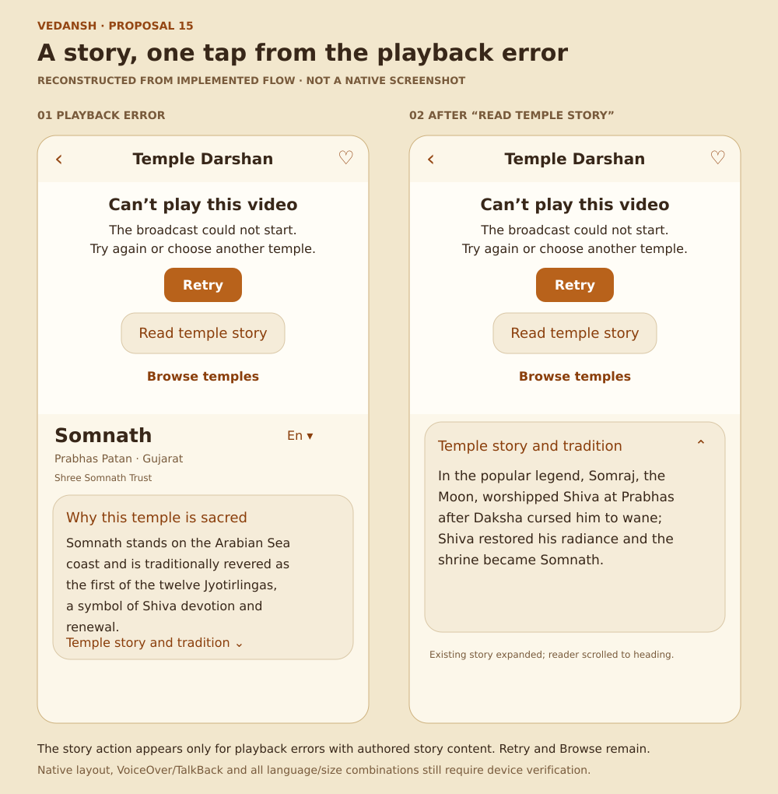

# Proposal 15 — Darshan error to existing temple story

PR: https://github.com/persisharma/aadhyatma/pull/725 (draft).
Branch: `codex/proposal15-darshan-story`.
Base: `c8ad35dd55b67991c9af23b809c3229a401e24f7`; extends merged #691. No overlapping open Darshan PR found at implementation time.
Initial remote checkpoint: `c2218d562796dc5bdcdc0fb85961e6750499fa40` (tree equals local `7b746da8`). The PR head identifies the final evidence/test follow-up; no production component changes after this checkpoint.

## Result and visual

One secondary localized error action opens the selected temple's authored story on the same screen. Retry/Browse remain. The action does not retry, remount or resume playback. Normal/healthy/loading video, favourites, route/back stacks and no-autoresume policy are preserved. No content, network source, telemetry or page added.

Reference: Library `libfile_64a78a48ef548191a699e184a378fc3b` (concept). The reconstruction retains real Somnath prose and implemented action order. Unlike the concept's side-by-side controls, it reuses the existing stacked error actions and shared secondary DarshanAction. The actual error state hides the playback control strip. This schematic is not a native render or typography/layout acceptance result.

## Executed verification

- **PASS** final targeted: 6 suites / 102 tests (`DarshanJourney`, `DockedYouTubePlayer`, `ChannelYouTubeFrame`, `YouTubeReadyPlayback`, `DarshanRoutes`, `darshanE2EResolver`). Includes localized error-only gating, absence/whitespace content, real story expansion, post-layout measurement/scroll/focus, repeated taps, stale native measurement after blur and same-screen route change, no playback claim/retry/navigation, and development fixture production exclusion.
- **PASS** regression proof: 11 selected new regressions FAIL against base production code in an isolated base worktree; corresponding final tests PASS.
- **PASS** final `npm run typecheck`; full `npm run lint` 0 errors / 515 warnings at implementation checkpoint; final changed-file ESLint 0 errors / 19 warnings. Existing require/import conventions account for warnings; no lint errors suppressed.
- **FAIL (inherited)** full reader gate: all three shards executed, 445 suites passed / 1 failed; 5,000 tests passed / 1 failed. `dailyBhaktiShare.test.ts:12` lacks a source artwork mapping. Reproduced on untouched base (`1 failed / 6 passed`). Final additions then passed the targeted run above; no claim that the entire repository gate is green.
- **FAIL (inherited)** data gate: 263 passed / 2 failed. Bhagavatam `reading-01.json` lacks declared provenance; `texts.ts` imports `./bhagavatam` instead of generated verse counts. Both reproduced in the base worktree. These unrelated content/data files were not changed.
- **PASS** widget gate 51 tests; engine gate 883; Ask gate 49; observance verification zero failures, divergences or rule drift.
- **PASS** agent-instruction verifier plus its 7 tests; `git diff --check`; all three affected Maestro YAML documents parsed.
- **Environment limitation:** literal `npm test` passes typecheck then the tsx CLI cannot create its local IPC socket (`EPERM`). Every remaining gate was executed independently with the same script arguments through `node --import tsx` (Node test concurrency 2); all three Jest shards ran unchanged. This does not waive failures above.

## Language, size and native matrix

| Evidence | hi / en / gu / kn | Standard / Large | Compact / enlarged system text | iOS / Android |
|---|---|---|---|---|
| Component/provider configuration | PASS all four | PASS both | PASS 320×640 with system scale 2; 390×844 scale 1; untruncated scalable label and bounded error scroller | Mocked RN only |
| Actual layout / Indic marks / touch reachability | PENDING | PENDING | PENDING | PENDING both |
| VoiceOver / TalkBack focus after layout | PENDING | PENDING | PENDING | PENDING both |
| Maestro journey / native playback / ANR profiling | PENDING | PENDING | PENDING | PENDING both |

This Linux environment has no `adb`, `xcrun` or `maestro` executable. Synthetic viewport/provider tests and the schematic are not device evidence. No native builds, release, deployment or OTA were performed. The 8/10 users reaching the story within 10 seconds metric is a future usability target, NOT validated.

## Deterministic native test

Start isolated Metro with `VEDANSH_DARSHAN_E2E=1 npx expo start --port 8084 -c` from `mobile`, then run `maestro --device <dedicated-device> test .maestro/darshan-story-error.yaml` against a development build. The explicit Metro resolver intercepts only dedicated source discovery and the channel frame in development: source resolves null and the frame reports error. It does not change route/data/content or depend on a live stream failing. Normal and production resolution stay unchanged, pinned by resolver tests. Also run existing `live-darshan.yaml` and fullscreen flow with ordinary Metro.

Run each native journey in hi/en/gu/kn, Standard/Large, compact/enlarged system text. Verify heading focus after expansion and repeated taps, Back/reopen and switching temple, saved state, background/foreground and no duplicate playback. Empty/whitespace localized stories are covered by synthetic unit fixtures; do not remove authored production content to fabricate a native case.

## Acceptance and remaining work

| Check | Result | Evidence / remaining gate |
|---|---|---|
| U1 source and scope | PASS | Current policies, main, #691, approved concept; one local feature |
| U2 acceptance | PASS | Error-only, real localized story, same screen, post-layout focus, no playback side effect |
| U3 actual native fidelity | PENDING | Reconstruction reviewed; native reference comparison unavailable |
| U4 language / size | PENDING | Provider matrix PASS; actual native script/layout matrix above outstanding |
| U5 full journey | PENDING | Unit route/back/favourite behavior PASS; native entry/save/Back journey outstanding |
| U6 lifecycle | PENDING | Unit blur/background/no-autoresume plus stale-focus route cancellation PASS; native interruptions outstanding |
| U7 content/assets | PASS | Existing complete authored prose and artwork; no publication/cache change |
| U8 sibling surfaces | PASS | Shared player keeps recitation recovery, healthy/loading states and channel readiness boundaries |
| U9 tests/native | FAIL / PENDING | Targeted PASS; inherited full-gate failures reproduced; native Maestro unexecuted |
| U10 / U10.1 compatibility and ANR | PENDING | Bounded one-frame measurement + focus, cancellable callbacks, memoized localized prose, no new startup source or polling; device profiling absent |
| U11 integration | PENDING | Based on latest main; final remote CI/review must pass or inherited failures be resolved separately |
| U12 preservation | PASS | Draft PR and remote checkpoint verified; local clone, base worktree and logs retained; final PR head/tree checked on handover |

C1/C7/C8/C9 apply (existing authored prose, navigation, video and accessibility). C2–C6/C10 N/A: no new illustrated content, artwork publication, exports, calendar/reminders or release work.

Keep draft until native evidence and repository gates are addressed. No merge or launch until reviewed.
