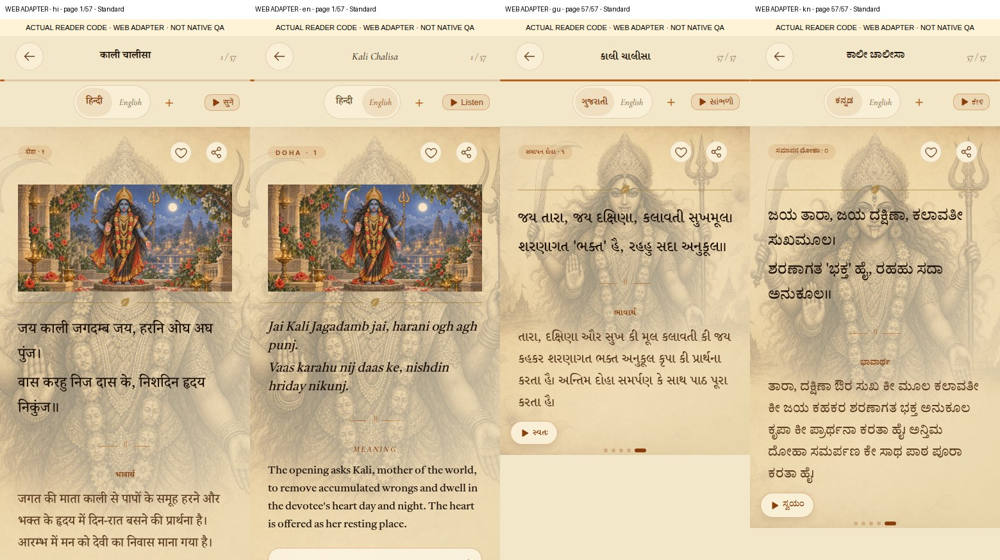

# A4 — Kali Chalisa

## Scope and acceptance

Base: `414ed58365e300c317dada0f96c0994074c09730` (implementation base, A3 merged). Isolated `feat/kali-chalisa` worktree. Only A4, deity `kali`, category `chalisa`, addedInVersion 1.5.7. No new artwork, audio, reader interaction, merge, release, OTA or next task. No other implementation is active in this worktree.

Read current AGENTS, build checklist, applicable RULEBOOK/design, repository instruction rules and reader/language wiki. The old checklist in `competitor-analysis/2026-10-19/claude-code-plan.md` is unavailable; under the authorized A2/A3 approach, current policy and the merged Chalisa pattern replace it. The Library plan was read in full. No open Kali PR found before edits.

Acceptance: the complete intended composition must render distinctly from other Chalisas in all four scripts; catalog/Kali deity/search/saved routes must select A4; correct existing Kali art, full text and honest counts; no public provenance UI. Actual-component visual is required as a deliverable but does not substitute for native tests.

## Complete-source collation

1. Drik Panchang: https://www.drikpanchang.com/lyrics/chalisa/kali-mata/kali-mata-chalisa.html — full traditional prayer read through web retrieval on 2026-11-16. Direct HTTP request and `?lang=hi` retrieval returned 403. Chosen edition.
2. Aaj Tak: https://www.aajtak.in/religion/chalisa/maa-kali-chalisa-2688359 — HTTP 200; complete traditional prayer read through web and direct retrieval. A secondary confirmation, not the sole authority.
3. Manifest candidate https://pavitragranth.com/chalisa/maa-kali-chalisa and alternative `/chalisa/shree-kali-chalisa` returned 403. Search snippets were not counted as a full read or used to construct text.

Both complete publications share two opening dohas, **54** body couplets in the same order, and one closing doha. The generic Drik introduction says forty, but the actual complete prayer is 57 reader units. Preserve it intact; do not import a different Mahakali composition or drop the final fourteen couplets. These are distinct publications, not evidence of independent manuscript lineages or universal consensus.

The selected composition opens जय काली जगदम्ब जय, हरनि ओघ अघ पुंज and ends शरणागत भक्त है, रहहु सदा अनुकूल. Source punctuation is retained, splitting body couplets at their danda into two lines.

| Unit | Drik retained | Aaj Tak comparison |
| --- | --- | --- |
| Body 15 | सहस्राक्षि | सहस्त्राक्षि |
| Body 23 | तिनमहँ | तिनमहं |
| Body 32,49 | दुःख | दु:ख |
| Body 37–39,42–43,46–47,53 | जहाँ/कहूँ/कहँ/माँ/हुँकारी/कतहुँ | corresponding anusvara spellings |
| Closing | straight quotes around भक्त | curly quotes and extra space |

Other units align in wording and order. Retain the complete Drik edition under the authorized chosen-edition approach; do not manufacture a majority. Obscure shared forms including हला, दाक्षाणायिनी, महातमा, अग जग, तब, भुजामल and किंकण remain unchanged. Glosses avoid invented etymologies. Meanings and ASCII pronunciation are original editorial work; modern publisher explanations are not copied. The fifty-two Peethas and eighteen arms are attributed to this hymn rather than asserted universally; battle imagery is not an instruction and benefits are devotional beliefs, not guarantees.

Full-text SHA-256: `36bc77cb73d3004083677b257d1e59c378cde39b418aa2d863554f170db6a6cc`, calculated by joining each unit's lines with spaces and units with newline. The content test pins the complete sequence.

## Integration and evidence

Existing `ChalisaReaderScreen` and `VersePage` production code are unchanged. Append-only additions to the registry, library, flat-reader route and search list, count generator and source validation. Existing `deity_kali` background and first-page illustration derive from the Kali deity tag. No new CDN publication is needed. `bestDays` is empty; no unsupported weekday prescription is introduced.

- U1/U2 PASS: source, scope, current policy, no overlap and acceptance established.
- U3/U4 PENDING native: actual-component browser render tracked separately below.
- U5/U6: listing/resume/bookmark/search and reader dispatch automated coverage; native persistence, Back, cold restart, offline and lifecycle pending.
- U7/C1/C3: full-source payload and existing semantic artwork mapping; actual-device delivery pending.
- U8 PASS scope review: A1/A2/A3 and Lakshmi patterns checked, no shared-reader behavior changed.
- U9: executed results recorded below; extended `chalisa-smoke.yaml` must run on both platforms.
- U10/U10.1: bounded 57-unit payload, no added launch-path corpus import or changed saved IDs; physical-device responsiveness/ANR and telemetry evidence pending.
- U11/U12: final rebase and remote checkpoint recorded below.
- C4/C7/C8/C9: existing sharing, saved routes, assistive playback and accessibility retained; native handoff/playback checks pending.
- C2/C5/C6/C10 N/A: no stories, calendar, reminders or release.

Native matrix: hi/en/gu/kn × Standard/Large × iOS/Android all PENDING. This Linux host has no Maestro/adb/iOS simulator. Required native checks keep the PR draft.

## Executed validation and visual

Implementation tested at local `83d5e241`; subsequent edits add only capture tooling and this evidence.

- PASS `npm run typecheck`.
- PASS focused `ChalisaReaderScreen.test.tsx`: 53 tests, including 20 A4 opening/second-opening/middle/last-body/closing cases across hi/en/gu/kn.
- PASS widgets 51; engine 842; data 242; Ask 49.
- Reader shards: 4,433 passed, 6 failed across 411 suites. All six failures are `YouTubeReadyPlayback.test.tsx`, reproduced separately on unchanged base `414ed583` (6/6 fail). No YouTube files changed by A4. Do not claim the full suite passes.
- PASS lint: zero errors, 480 existing warnings. PASS `git diff --check` and instruction-entrypoint verifier.
- `npm test` itself stops in the tsx launcher because Unix IPC socket creation is denied. All constituent suites were then executed independently with `node --import tsx --test` or the Jest CLI, preserving logs under `/workspace/scratch/60871f9ef02f/a4-*.log`. An initial overbroad copied alias test was corrected before the full data suite passed.
- PASS build of `mobile/visual/kali-chalisa/build.mjs`: actual production reader and data bundled with explicit web adapters.
- Initial local capture attempt was blocked by Chromium socket restrictions. GitHub subsequently captured the component successfully; see the dated evidence below.
- PENDING Maestro/native, all languages/sizes/platforms, device artwork/cache/export/playback/lifecycle/ANR evidence.

## Main integration and published evidence — 17 November 2026

PR: https://github.com/persisharma/aadhyatma/pull/698 (draft). Published branch: `feat/kali-chalisa`.

The user explicitly authorized public publication of the A4 code, tests, documentation and capture workflow. The earlier approval-review blocker is resolved; the initial checkpoint was `96bd9702188ffd17170bf1f1777235a5c30a2754`.

Current main `a8f6046d57f44965f21774228905572a44472646` integrated cleanly, preserving A3's documentation/capture corrections. There were no textual conflicts; the earlier initial GitHub mergeable=false snapshot did not establish a conflict. GitHub reports the integrated PR mergeable. A4's HTML now explicitly declares UTF-8, matching A3. Integrated implementation/capture head: `b18261cf2ab431ca679e813ba4bfffe0ec247672`, tree `b50ac484908d881ecda91006c4e5b49084012b93`, exactly matching local `0f3b5312`. Subsequent evidence-only changes do not alter production code.

After integration: typecheck PASS; actual reader suite 53/53 PASS; targeted content/search/count/source-ID/routes run 8/8 test entries PASS (several files use their own assertion harness); actual component build, instruction verifier and whitespace check PASS. Main's intervening change only touched A3 documentation and capture tooling, so the prior complete-suite evidence and its six reproduced baseline video failures remain applicable; full CI is additionally running on the published integration head.

### Actual-component visuals

The GitHub capture workflow succeeded on initial published head `96bd9702`: https://github.com/persisharma/aadhyatma/actions/runs/44077382072 . Artifact `a4-kali-actual-component-web-not-native` contains 24 PNG screenshots and corresponding text captures: hi/en/gu/kn × Standard at 390×844 and Large at 320×844 × zero-based pages 0/28/56. All 24 were visually reviewed as four six-image sheets. The selected first, middle and last verses and correct Kali illustration/background are visible; no encoding corruption was seen. These are production reader/VersePage imports rendered through web adapters, not a re-created design and not an installed native app.

The committed contact sheet shows Hindi/English opening and Gujarati/Kannada closing at Standard. Full capture output is retained in the Actions artifact. The explicit UTF-8 integration head triggers a repeat capture at https://github.com/persisharma/aadhyatma/actions/runs/44078017193 .

**Unresolved visual limits:** compact 320px/Large English and Gujarati show crowding/overlap between the plus and Listen controls in the existing shared reader header's web rendering. Native parity is unverified; this is not asserted to be a native defect or silently counted as a pass. Long content extends below the viewport in several captures; these screenshots alone do not prove scroll reachability. Enlarged OS text, longest-page selection, every intervening page, saved journeys, gesture navigation, playback and actual share exports remain pending. No shared production header was modified in this A4 content task.

### Native and delivery limits

This Linux environment has no `adb`, `maestro` or `xcrun` executables. No emulator/device or native flow was executed. Native hi/en/gu/kn × Standard/Large, enlarged system text, Back/persistence/offline/lifecycle, export/playback and physical-device ANR evidence remain PENDING. A browser capture cannot clear these requirements. Keep PR draft; no merge, release, OTA or next item.

U11 PASS for current-main integration and affected local checks; CI status is reported separately on the PR. U12 PASS for remotely preserved implementation and this evidence. Required task files are committed; the two untracked dependency symlinks are tooling only. No cleanup was performed.

## Compact control correction

`ReaderControlRow` replaces Chalisa's unreserved absolute Listen slot. It measures the language/routine group, playback control and available width, retains the centred layout when it fits with 24pt touch clearance, and otherwise puts the full labelled playback action on its own right-aligned row. It starts stacked until measured and remeasures after locale/text/width changes. The fix applies to every Chalisa through the shared reader; no content IDs or playback callbacks changed. Sibling reader families still use similar fixed slots; they were audited but not bulk-migrated in this A4 task.

Typecheck PASS. Reader/control suites 55/55 PASS, including resize and longer-label measurements. Component build and syntax/whitespace checks PASS. The capture workflow now covers hi/en/gu/kn × widths 320/390 × Standard/Large × pages 0/28/56 = 48 captures, rejecting overlapping control boxes or an out-of-viewport trailing control. Final capture/CI outcomes are recorded in the PR description. Earlier contact-sheet evidence predates this header correction. Native system-text/gesture/persistence/playback/ANR checks remain pending.
