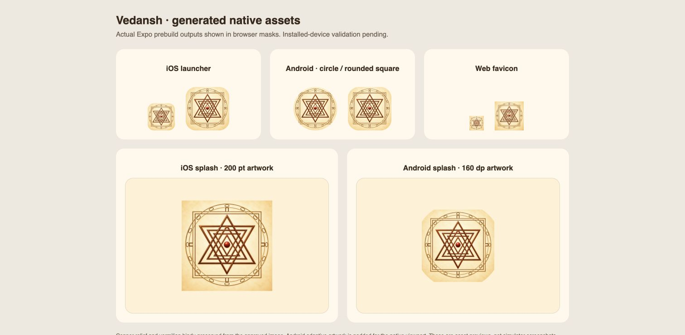

# Approved app-icon integration

The user approved the enlarged copper relief geometry, warm ivory field and distinct vermilion bindu after comparison at small launcher sizes. The exact approved source is `mobile/assets/branding/app-icon-master.png`; its SHA-256 is `9a1cf0b61d59bf9700c8c2ebf816cf35708efcc27a65d708eb94b4c22c036796`.

All existing logo image slots now derive from this master: iOS/legacy launcher, Android adaptive launcher, native splash and web favicon. Home's Om-flanked wordmark, text-only share footer and navigation/control symbols do not use the old app icon and retain their existing presentation.

## Reproduce

After `npm ci` in `mobile/`, run `node mobile/scripts/export-app-icons.mjs` from the repository root. This resizes/packages the approved image without regenerating its geometry and writes the hash/dimension manifest beside the master. Native resources are generated from `mobile/app.json` by `npx expo prebuild --no-install` in `mobile/`; generated `ios/` and `android/` directories remain gitignored.

Android's 108dp adaptive layer contains the artwork in its 72dp viewport. The essential central symbol fits within the 66dp safe circle; peripheral framing is decorative. The splash plugin uses 200pt on iOS and 160dp on Android, against `#FFF1D5`. This is brand artwork, not a verified canonical Shri Yantra.

## Evidence

- Exact approved-master identity, four exported hashes/dimensions, opaque RGB launcher/splash/favicon, Expo references and splash configuration checked.
- Re-running the exporter produced the identical manifest and image hashes.
- `npm test` after reconciling with `origin/main` at `59d2282d`: exit 0; TypeScript plus 3,113 passing tests (2,264 Jest tests across 235 suites; 37 widget, 590 engine, 173 data and 49 Ask tests).
- `npx expo prebuild --no-install`: exit 0 for iOS and Android. Existing warning: Android `userInterfaceStyle` needs `expo-system-ui`; unrelated to this icon change.
- Generated iOS app icon is byte-identical to the 1024px export. `xcrun actool` compiled the generated asset catalog and `xcrun ibtool` compiled the splash storyboard, both exit 0.
- Generated native icon and splash assets inspected in browser previews with iOS-like rounded corners and Android circle/rounded-square masks. The preview below is not a simulator capture.
- Full native app compilation, installed-device launcher/splash checks and Maestro E2E remain pending. Expo Go or an OTA update cannot validate these native-shell changes; release requires a new native build.

Platform references: [Expo icon and splash guide](https://docs.expo.dev/develop/user-interface/splash-screen-and-app-icon/), [Android adaptive-icon safe zone](https://developer.android.com/codelabs/basic-android-kotlin-compose-training-change-app-icon).
