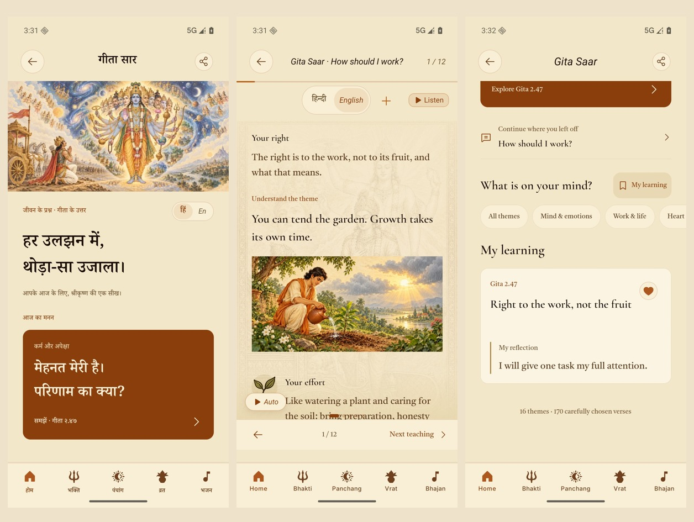

# Gita Saar native redesign · 26 October 2026

The approved continuous-learning prototype is implemented in the mobile app across all 16 existing themes and 170 teachings. The original scripture corpus, Saar text, theme ordering, page IDs, bookmarks and progress identities are preserved.

## What changed

- A source-specific devotional opening, a direct Gita 2.47 entry, reading resume, optional theme filters and complete question-led theme cards.
- Each teaching starts with its existing plain-language Essence. Original scripture and corpus meaning are available inline; the full-Gita handoff opens the exact original verse.
- Group openings include a paired editorial explanation. Every teaching has a theme-specific takeaway and an optional reflection. The approved garden scene illustrates karma's opening teaching.
- Writing is optional. Done dismisses the keyboard; one save keeps the teaching and its reflection. My learning combines existing bookmarks and private writing, with direct reopening.
- Explicit previous/next controls cross themes while retaining native swiping, measured vertical scrolling, source artwork, routines, share, narration and auto-slide. Private writing is excluded from share and narration.

## Native verification

The core Maestro journey passed on an iPhone 17 Pro / iOS 26.5 simulator and an Android API 36 emulator: Home → Sacred Books → Gita Saar → featured teaching → original verse disclosure → painted explanation → keyboard input → save → next/previous → My learning → saved teaching → full Gita at **47 / 72**. Screenshots were visually inspected, including the downloaded garden artwork.

- iOS reflection persistence after stopping and relaunching the app: passed.
- iOS Gujarati and Kannada at Large reading size: passed, including theme 16 and scrolling to the takeaway/reflection action.
- Android reflection persistence after stopping and relaunching the app: passed.
- Android Gujarati and Kannada at Large reading size: passed, including theme 16 and scrolling to the takeaway/reflection action.

The iOS walkthrough used an existing native debug client with this worktree's JavaScript. Android also compiled successfully from this checkout. Final Android evidence uses a **local debug-signed capture build with embedded production JavaScript**, developer support disabled and OTA disabled in the ignored generated Android project. These capture settings do not change tracked production configuration. This avoids development prefetch memory overhead; the captured app used approximately 300 MB PSS. No cloud build, app upload, OTA publication or version bump was performed.

## Defects found during verification

A cold navigation could crash Android Fabric while reattaching an already-parented SVG path. The shared `lazyScreen` loader now resolves cold modules through a cancellable effect, retaining synchronous warm screens, error-boundary retry and mounted screen state. The same native journey passed after this change. Existing loading tests were strengthened to verify local state survives a subsequent warm update.

Android API 36 can type unusually slowly in Maestro; the complete text-entry journey was allowed to finish and passed. See the upstream [Maestro issue](https://github.com/mobile-dev-inc/Maestro/issues/2718). Screenshot-only or partial runs are not counted as a complete journey.

## Automated checks and delivery

`npm test` passed: **3,748 tests**, including all 291 reader Jest suites. This includes the source/reference integrity checks, all 16 bilingual learning frames, stable 170-page identities, typography, durable reflection writes, failed-read retry and save-error draft preservation. TypeScript and changed-file lint pass (two existing lazy-require warnings). Repository-wide lint retains three existing `react/jsx-key` errors in unchanged `ReaderActionTargets.test.tsx:20–22` and 381 warnings after main reconciliation.

Both final iOS and Android Hermes exports passed. The new garden image is absent from both bundled asset maps; its immutable CDN object was fetched and matched against the full source hash. See `garden-provenance.json`, `checks.json`, platform screenshots and journey logs.

Native evidence covers representative opening/last-theme journeys, not a manual visual review of every one of the 170 teachings. Physical-device performance, spoken-audio quality and VoiceOver/TalkBack review remain release checks. New learning frames are labelled editorial; existing scripture and Saar are unchanged.

Native captures used base `61f79cea` plus this feature. Three unrelated main commits through `df1b511a` were subsequently reconciled without changing the Gita Saar implementation. The complete suite passed again after reconciliation (3,748 tests). Results are recorded in `checks.json`.
