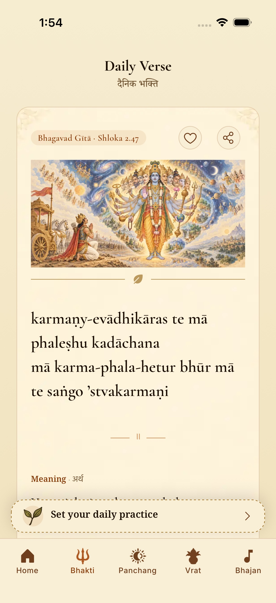
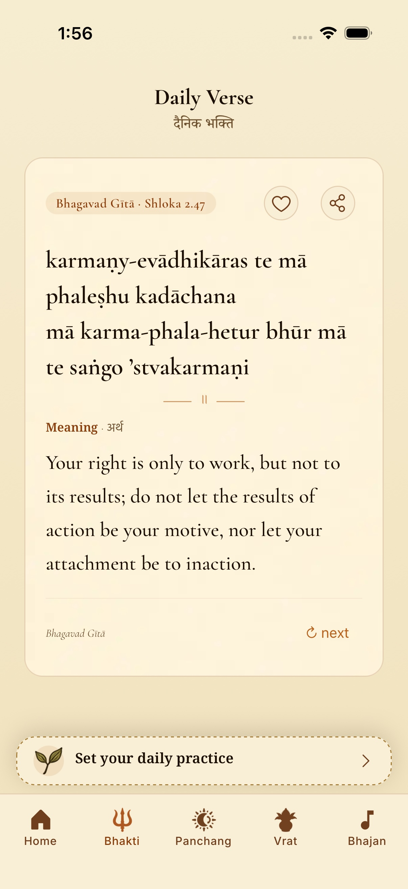
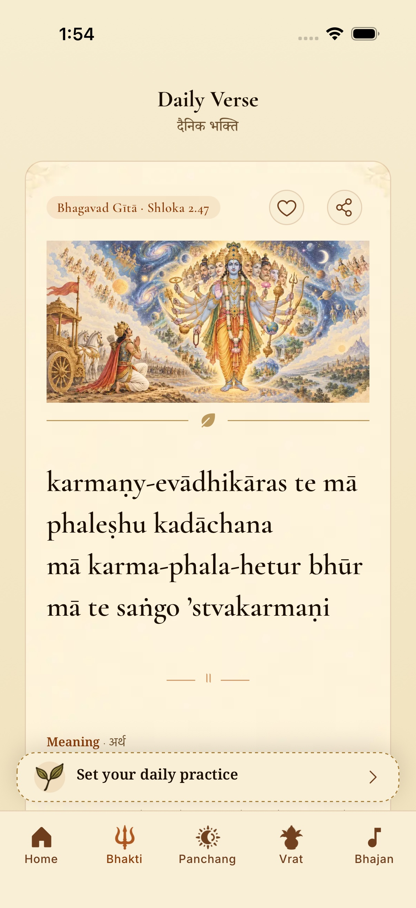
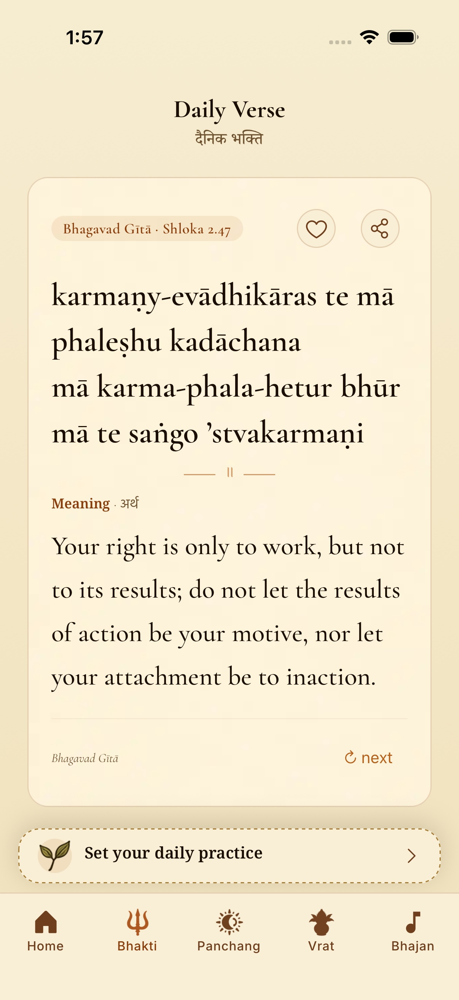

# Daily Bhakti: keep the reading in view

The daily verse card no longer mounts an illustration banner. It keeps bundled parchment,
full verse/meaning text and the shared reading-size tokens. The verse-to-meaning ornament
now uses 12pt total vertical margins instead of 80pt (the old outer wrapper plus ornament).
Long content still scrolls; no universal one-screen promise is made.

These are actual iPhone 17 Pro / iOS 26.5 screenshots of Gita 2.47 with the same source,
language and reading size. Full frames are retained; JPEG copies keep review files smaller.

| English Standard: before | English Standard: after |
| --- | --- |
|  |  |

| English Large: before | English Large: after |
| --- | --- |
|  |  |

The inspected English Standard/Large cards now show the complete verse, meaning and Next
control together. Hindi [Standard](after-hi-standard.jpg) and [Large](after-hi-large.jpg)
were also inspected for full text, wrapping and the smaller gap. The shared export continues
to use its existing source-specific background; this correction changes only the daily reader.
A [native shared Gita card](native-share-card.jpg) confirms the background paints in the export.

### Long-content stress check

Ganesh Stotram 2.11 (Phalashruti) contains 12 verse lines plus a long meaning. At Large,
[the opening](after-long-en-large-opening.jpg) naturally requires scrolling;
[the endpoint](after-long-en-large-end.jpg) shows the complete meaning tail and Next control.
The stress flow passed its scroll-down, meaning and endpoint screenshot steps, then failed
its separate scroll-up share-button selector. A fresh share-only flow passed and generated
the actual PNG. The committed daily smoke remains passing.

**Sharing limitation observed before the tall-image follow-up:** [the long native share export](existing-long-share-clipping.jpg)
clips verse lines and omits the meaning/footer on the fixed canvas. This predates the daily
layout correction: `ShareCard` and `shareCardType` are unchanged. Long verse sharing needs
a separate pagination correction; do not interpret the successful short export or reader
scrolling as proof that every shared verse fits. No message or external post was sent.

## Verification

- The revised daily-layout unit contract fails on the original banner, then passes after removal.
- Full `cd mobile && npm test` passes on current main `324aea00`: TypeScript; 37 widget tests;
  242 Jest suites / 2,335 tests; 590 engine, 173 data and 49 Ask tests (3,184 total).
- Focused Daily Bhakti, type-scale and sharing suites pass: 21 tests. Touched-file ESLint is clean.
- Updated `mobile/.maestro/daily-bhakti-smoke.yaml` passes with exit 0 on the final exported JS:
  known verse at Standard/Large, immediate Standard meaning, share chooser, Next and setting restore.
  [Executed smoke](maestro-smoke.log).
- Before/after comparison flow passes in English and Hindi at Standard/Large; native share generation
  reaches the OS share sheet, with the actual short and long exports visually inspected. No message or external post is sent.
- [Exact JS and screenshot hashes](verification.json). The final installed JS is checked against
  the fresh production Hermes export. R2 sources, manifests, the shared lifetime cache and other
  reader layouts are unchanged. The daily paper itself resolves locally and creates no banner request.

The before/after comparison uses main `0ea0a627` as its baseline. Main's subsequent 1.5.1
release metadata (`324aea00`) was incorporated, then all tests, production JS embedding and
the committed native smoke were rerun. Screenshots use the same unchanged layout source.
This embeds fresh production JS in an existing Release shell; it is not a new native compile.
Only the ignored QA copy disables OTA to make source deterministic. No release/OTA was published.
Android runtime, physical-device and frame-time/CPU/memory benchmarks are not claimed.

The isolated QA simulator was given the previously verified corporate inspection root
(fingerprint `5dee1b47c5dd97886586e1cb1669a6c5df31393323109b7eae020c0d0fcd6234`)
so native HTTPS backgrounds can paint, as in the October 11 R2 follow-up. App transport
security and the shared simulator installation were not modified.

The above long-share gap is now resolved by the [one taller image follow-up](../tall-verse-share/review.md), which includes four-language native exports and short/story checks.
