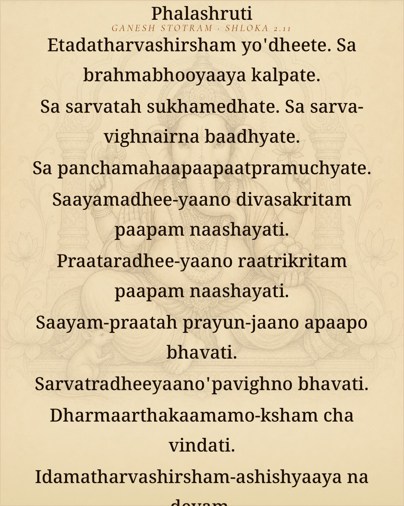
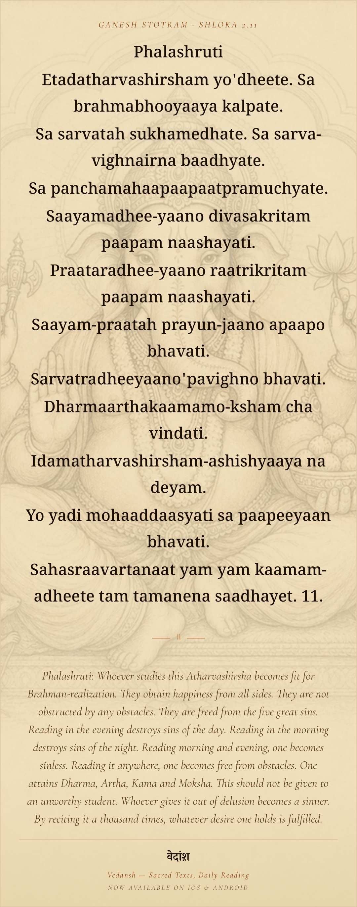

# Complete verse shares in one taller image

Long verse shares now grow vertically from actual native text layout. The full verse,
optional theme title, meaning and branding remain at readable sizes in a single PNG.
Short cards retain their 1080×1350 export; short story shares retain 1080×1920.

The shared card uses a 540dp width and 675dp minimum height, 24/40 verse and 18/27 meaning
with no text line caps or platform font shrinking. Its capture ancestors also have no
fixed height while measuring. The provider waits for a capture-specific native height,
resizes the final capture frame, then waits for the existing background-paint barrier.
Missing layout times out after five seconds and shows the existing retry alert; it never
exports a guessed short frame or substitutes a partial caption for the requested image.
Measurement and mounting start only after choosing a share destination. Readers and startup
have no new measurement work. R2 sources, manifests, persistent caches and backgrounds are unchanged.

## Before and after: Ganesh Stotram 2.11, English

| Before: clipped at 1080×1350 | After: complete at 1080×2740 |
| --- | --- |
|  |  |

These are actual native exports, not mockups. The after image includes all 12 verse entries,
the complete meaning ending “whatever desire one holds is fulfilled”, and the full footer.
The earlier [long-share gap](../daily-bhakti-space/review.md) is resolved by this follow-up.

## Native checks

All seven cases passed on the isolated iPhone 17 Pro / iOS 26.5 simulator, and every exported
file was visually inspected for its source header, last verse, meaning tail and footer.

| Case | Native PNG dimensions | Review |
| --- | --- | --- |
| Long English | 1080×2740 | [Full image](long-en.jpg) |
| Long Hindi | 1080×1976 | [Full image](long-hi.jpg) |
| Long Gujarati | 1080×1972 | [Full image](long-gu.jpg) |
| Long Kannada | 1080×2300 | [Full image](long-kn.jpg) |
| Long English story frame | 1080×3310 | [Full image](long-story.jpg) |
| Short English, Gita 2.47 | 1080×1350 | [Full image](short-en.jpg) |
| Short English story frame | 1080×1920 | [Full image](short-story.jpg) |

Story framing keeps its 120dp top / 165dp bottom breathing room and grows with the verse.
The verse target picker keeps all three destinations, removes fixed aspect promises, and
explains that tall images may need framing adjustments in Instagram. Prose/picture series
retain their existing fixed card geometry. No message or external post was sent.

## Verification and limits

- Full `cd mobile && npm test` passes: TypeScript, 37 widget tests, 241 Jest suites / 2,335 tests,
  590 engine, 173 data and 49 Ask tests: **3,184 tests total**.
- Focused sharing checks pass, including full uncapped text in all four languages, actual
  height readiness, unconstrained initial capture frame, density-correct dimensions,
  short-after-long reset on the same provider, bounded missing-layout handling, and remote/
  fallback background painting. Touched-file ESLint is clean.
- [Exact installed production JS, native image hashes and per-case logs](verification.json).
  Fresh production Hermes JS was embedded in an existing Release QA shell; this is not a
  new native compile. Only the ignored QA shell disables OTA for deterministic testing.
- JPEG review copies retain each full PNG frame and dimensions, quality 87, with no crop or resize.
- This verifies the selected long/short native examples and shared layout pipeline. It does
  not claim an exhaustive native export of every verse, physical-device/Android runtime,
  Instagram publication, or frame-time/CPU/memory benchmarks. Longer files necessarily use
  more image memory during sharing; no extra image or text measurement runs while reading.
- No asset upload, release or OTA was published.
