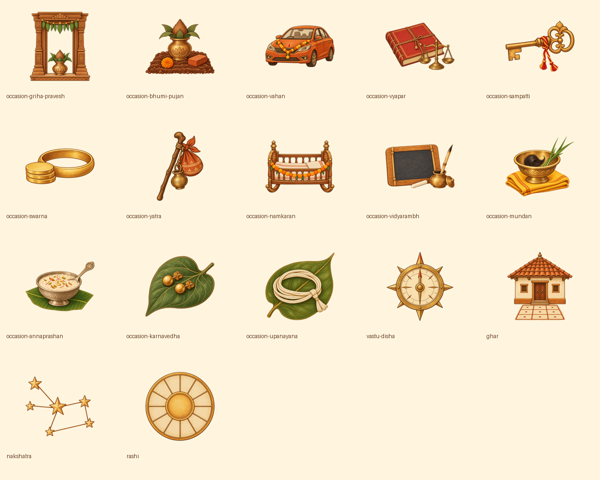

# Remaining painted icon integration

Seventeen original, individually generated transparent paintings replace the remaining navigation letter tiles. The shared registry now has 56 subjects; More retains its separate 17 (73 overall). The original 39 exports are unchanged.

| Surface | Replacement |
| --- | --- |
| Muhurat occasion picker | Thirteen distinct `occasion-*` subjects, 44dp within the existing 52dp thumb |
| Muhurat results and Vastu | `vastu-disha` / `ghar`, 44dp |
| Namkaran browse | `nakshatra` / `rashi`, 40dp |
| Namkaran result → Muhurat | Existing `muhurat`, 40dp |
| Purpose and observance → Daan | Existing `daan`, 36dp |
| Custom Kuldevta | Existing `deity`, 44dp in the 54dp disc; complete entered name retained |
| Panchang Katha / Puja Vidhi | Existing `sanskar` / `vrat`, 34dp |
| Kundali overview | Existing `kundali`, 30dp; shared `moon` / `gochar` duotones, 23dp |

Meaningful naming syllables, name-index initials, the 108 count and civil dates remain text. Parent controls retain their labels, routes and hit areas. StoryIcon images remain decorative and hidden from accessibility.

## Provenance and export

`masters/` contains the original 17 generated PNGs recovered after the session reset. `sources.json` records their original filenames and SHA256 hashes; `generation-brief.md` retains the fifteen Muhurat/Vastu prompt specifications and approved style reference. The reference board is `../storybook-icons-2026-10-06/selected-storybook-reference.png`.

The exact original tool request strings for the two later naming paintings were lost during the reset. `prompts.json` records this gap explicitly; they have not been reconstructed or misrepresented as exact prompts. Recover these before final provenance sign-off.

Run `python3 docs/evaluations/remaining-icons-2026-10-16/export.py` from the repository to reproduce the exports. Export clears alpha below 8, fits the longest visible side to 432px, centers it in a 512px square and compresses to a 256-color alpha palette. The manifest pins master/export hashes, dimensions, bounds and bytes. The original 39 retain their 1.5MB cap; fifteen Muhurat/Vastu subjects have a 750KB cap and two naming subjects a 150KB cap.

## Verification

Validation on the restored integration: 262 Jest suites / 2,546 tests pass. After adding the custom Kuldevta regression and artwork assertions, all five affected suites / 42 tests pass. Typecheck passes; changed-file ESLint reports zero errors (58 existing warnings). Pure widget, engine, data and Ask suites pass using `node --import tsx --test`, since the tsx CLI IPC socket is unavailable here. Four Maestro flow files parse successfully. Asset contracts verify file hashes, source masters, transparency, dimensions, centered bounds and budgets; screen tests retain accessible routing and check decorative artwork.

Native Standard/Large visual review and Maestro execution remain pending: no simulator or Maestro is available in this workspace. The contact sheet above is artwork evidence, not installed-screen evidence. Updated Maestro screenshot checkpoints cover the Namkaran browse and Panchang reading doors; review custom Kuldevta and Kundali overview on both platforms as well. No release build or OTA was made.
