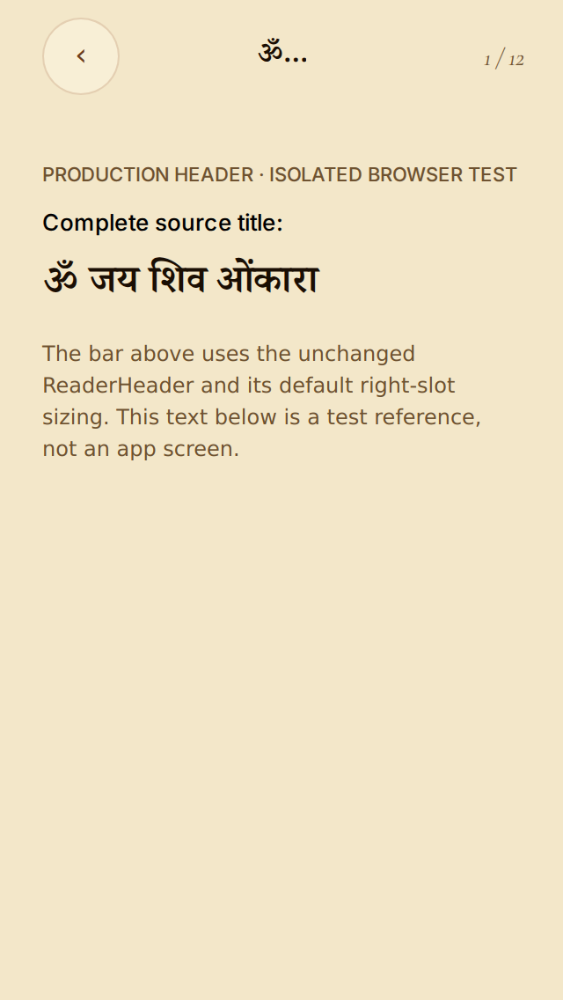
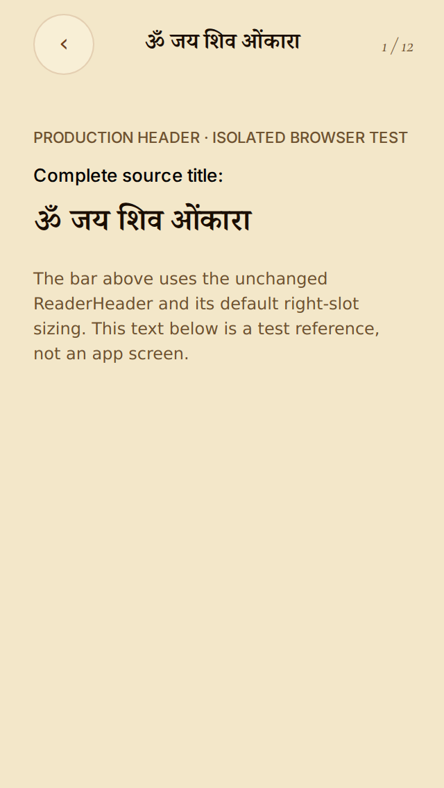
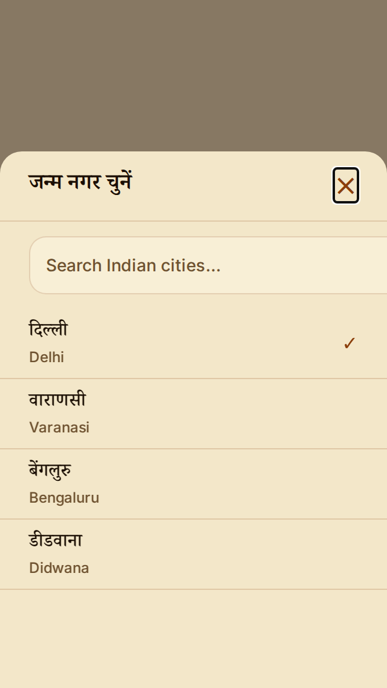
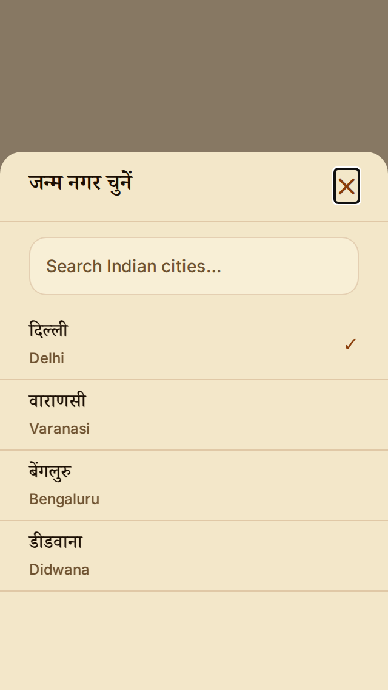
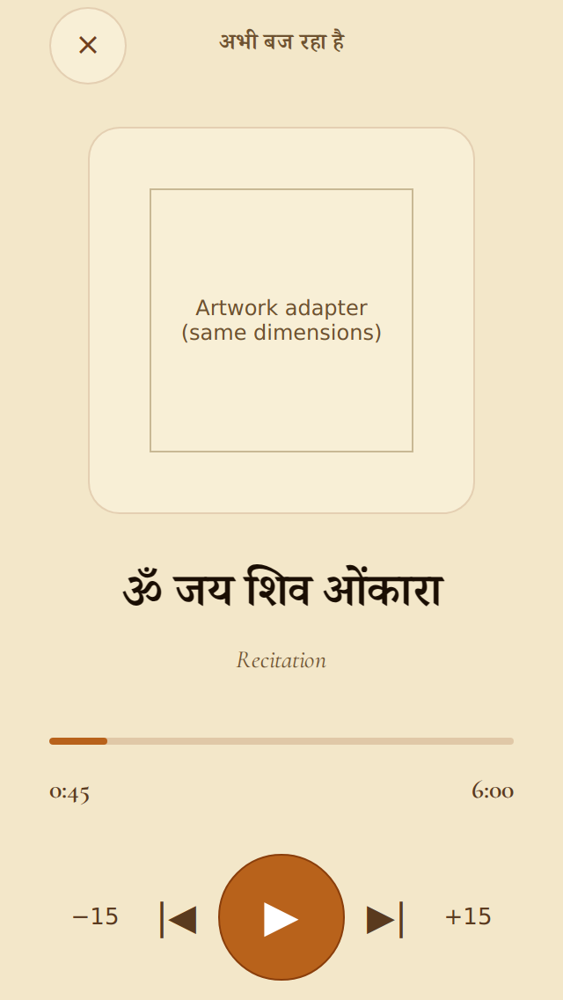
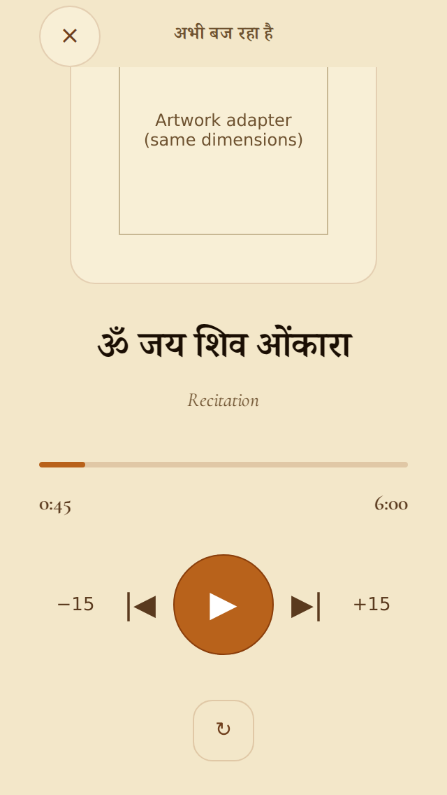

# Screen-clipping corrections — 5 November 2026

Base: e759b98122fd3cc6e863e7df4f879f2b2cf74d08.

## Scope and acceptance

Complete localized reader titles retain readable type and Back/action access. Kundali city search stays inside its clipped sheet while filtering, selecting and dismissing as before. Now Playing preserves playback/seek/repeat/minimize callbacks and makes all body content scrollable on short screens. No saved IDs, data, engines, assets, release versions or OTA configuration change.

Universal U1–U12 apply; C1/C7 protect readers and Back, C8 audio, C9 shared UI/accessibility. No new authored content/artwork or calendar computation; other conditional groups are N/A.

## Verification status

Source and remote checkpoint: `0b3b7a968072b0fcdcd334a129ce525caa46643c` (includes main `38d70305`). Subsequent evidence-only updates do not change application or test code.

| Check | Status | Evidence |
| --- | --- | --- |
| Before baseline, 72 browser cases | PASS reproduction | 24 truncated headers, 24 clipped city fields, 8 unreachable repeat controls; baseline success means the harness ran, not that layouts passed |
| Fixed browser matrix, 144 cases | PASS | Zero assertion failures or page errors; four languages, M/L, 320×568 / 360×800 / 390×844, 1× and 1.6× browser text |
| Changed-surface Jest regressions | PASS | 25 tests across ReaderHeader, KundaliExperience and NowPlayingScreen; reverting source to baseline makes 8 assertions fail |
| Updated onboarding integration fixture | PASS | 12 tests; explicitly decline the new setup widget offer before checking later retries; no onboarding production changes |
| Mobile gates | PASS after fixture restoration/reruns | Typecheck; all 339 Jest suites / 3,268 tests accounted for across three shards and failed-suite reruns; 46 widget, 630 engine, 218 data and 49 Ask tests. Initial failures were missing sparse-checkout JSON/artwork; restored exact Git bytes, no test skips. This was not one uninterrupted green `npm test` run. |
| Agent instruction policy, diff whitespace, 3 Maestro YAML files | PASS | Policy script, git diff --check and js-yaml parse |
| Final GitHub CI | PENDING | Earlier CI exposed stale onboarding assumptions introduced on main; fixture correction included |
| Installed iOS/Android visual, OS text scaling, real playback, keyboard and safe areas | PENDING | No simulator/emulator/device available; required native checks keep PR draft |

The local `tsx` CLI tries to open a blocked IPC socket. The same test entrypoints are run with its loader via `node --import ./node_modules/tsx/dist/loader.mjs`; assertions and test arguments are unchanged. The temporary node_modules shim is not committed. Recovered-checkout omissions affected Suvichar, brand, storybook provenance and kids-story fixtures; each failed suite passed after exact Git files were restored. A complete-checkout GitHub CI run remains the final integration gate.

## Visual proof

These are production-component browser renders with native adapters, not installed-app screenshots. CityPicker uses the unchanged production function/stylesheet and four city fixtures. Audio/icons/art use dimension-preserving adapters and read-only state. Native safe-area insets are zero; Linux Indic fallback faces use the app fonts. Full journey and callback tests are separate Jest checks. Reproduce with [the harness instructions](../../mobile/visual/layout/README.md).

| Surface, Hindi M at 320×568 | Before | After |
| --- | --- | --- |
| Full reader title |  |  |
| City search bounds |  |  |
| Reachable repeat after scrolling |  |  |

Raw measurements: [before](2026-11-05-screen-clipping/before-results.json), [after](2026-11-05-screen-clipping/after-results.json).
