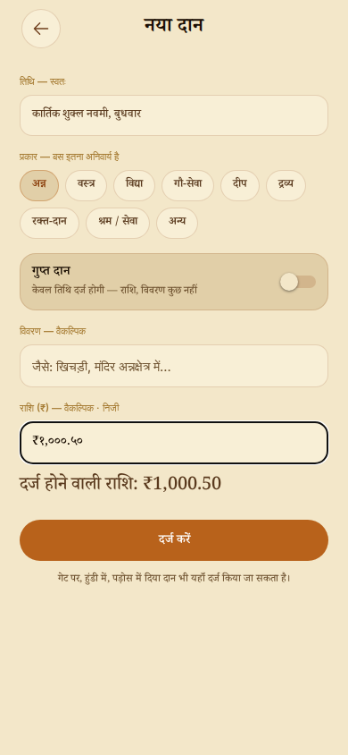
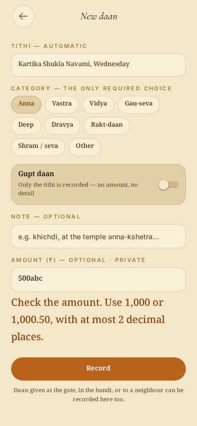

# Proposal 11 — full-input Daan amount validation

Base: main `0bc85510c842e4521082303d2de1e01c70a1f1b1`. No open Proposal 10 implementation was found. Keep its prospective date/tithi work separate from this guard. PR #703 independently changes keyboard wrapping/save errors; retain both during integration.

## Behavior
New records only. Accept INR prefix, outer whitespace, ASCII/Devanagari/Gujarati/Kannada digits and valid Indian or international grouping. Period separates up to two decimal digits. Reject signs, exponents, embedded whitespace, malformed grouping, suffixes, decimal comma, unsupported digits and unsafe numeric representation. Bound pasted input at 128 characters without truncating it. Zero and blank retain their existing meanings. Amount preview uses explicit INR and two decimal places. Invalid save announces and displays a correction without losing the draft or navigating. Gupt bypasses and hides the amount and existing sanitization strips it before storage. Historical values, schema, CSV and date logic are unchanged.

The currency field is the only partial numeric parser found in Daan entry surfaces. No additional financial parser or historical sanitizer was changed. Save remains blocked until ledger hydration finishes. Existing optimistic persistence behavior is not a durable-write guarantee.

## Evidence / acceptance
- PASS: 62 focused parser/form tests, including real provider storage, JSON hydration, CSV, all four scripts, Gupt, invalid correction and preserved note.
- PASS: regression verification against the original form: 8 of 10 new form tests fail; fixed form passes all 10.
- PASS: TypeScript, focused ESLint and diff whitespace check.
- PASS: all independent mobile gates: 4,532 Jest tests across 414 suites, 51 widgets, 842 engine, 242 data and 49 Ask tests. One Gita illustration test timed out on the first shard-3 run; it passed in isolation and then the complete shard passed (1,452 tests). The npm wrapper encountered a restricted tsx IPC socket; equivalent `node --import tsx --test` ran the non-Jest gates.
- PASS: actual-component browser matrix, Standard 390px / Large 320px in four languages: 16 captures, eight automated scenarios; valid/invalid editing and stored amount verified, no horizontal overflow. Manually reviewed one state in each of the eight language/size configurations. [Browser job](https://github.com/persisharma/aadhyatma/actions/runs/44285010547) succeeded on implementation head `51215cec9ad3e2f0647f0603a719c9dd58b7ced7`. [All 16 captures](https://github.com/persisharma/aadhyatma/actions/runs/44285010547/artifacts/14417954263). Local Chromium could not start due to EPERM; CI supplied the actual evidence.
- PENDING: native iOS/Android, Maestro flow, keyboard/VoiceOver/TalkBack, enlarged OS text, low-end-device responsiveness, offline/restart journeys and performance/ANR telemetry. No emulator, Maestro or existing test build is available here; no native build was started.
- N/A: scripture/artwork/CDN changes, reminders, audio, payments, release/store/OTA operations.

U1/U2/U8/U10 static review: bounded parser, no new libraries or startup listeners, no historical migration. U3/U4/U5/U6/U9 native acceptance remains pending. U7: no new assets. U11: overlap recorded. U12: preserve branch and draft PR, never merge from this task. Applicable conditional checks: C4 (CSV), C7 (saved records), C9 (form accessibility). Remaining conditional checks are outside scope.

Keep draft until required native acceptance is verified. No claim of a production fix or release.

## Delivery
Draft PR: https://github.com/persisharma/aadhyatma/pull/705
Branch: `codex/daan-amount-validation`. Tested and remotely verified implementation: `51215cec9ad3e2f0647f0603a719c9dd58b7ced7`. Subsequent evidence-only commit adds this result and two representative captures; production code is identical. Native acceptance remains pending; nothing merged or released. No cleanup was performed.

